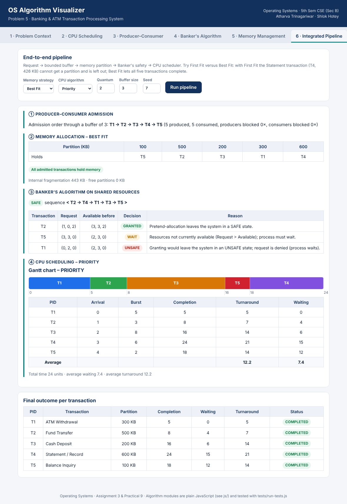
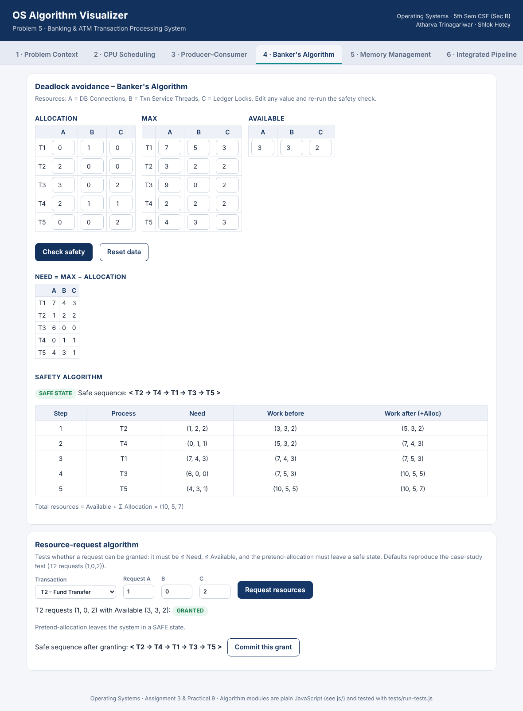
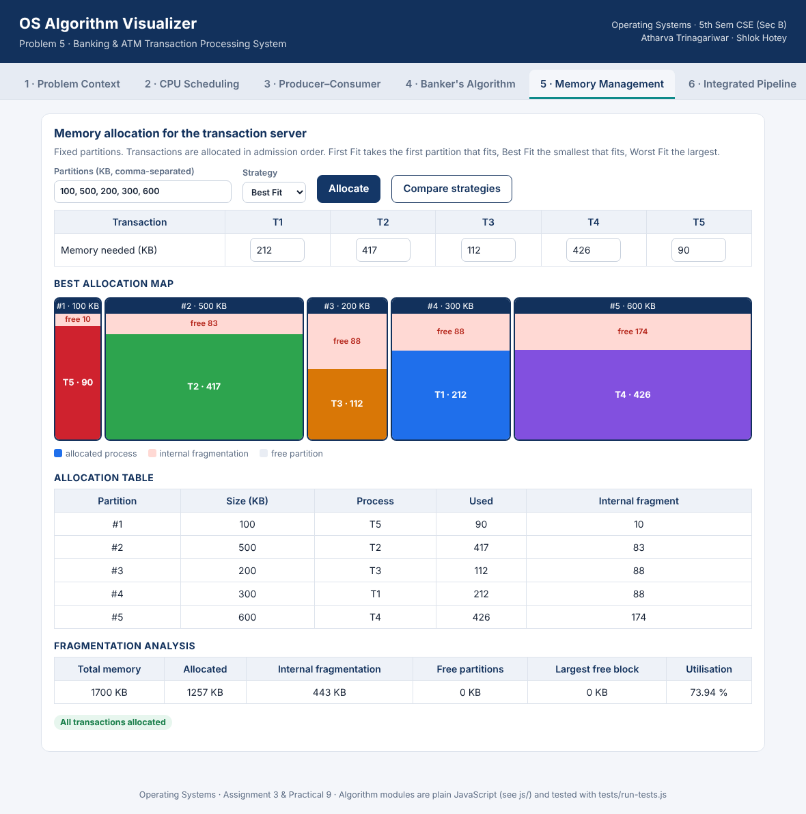
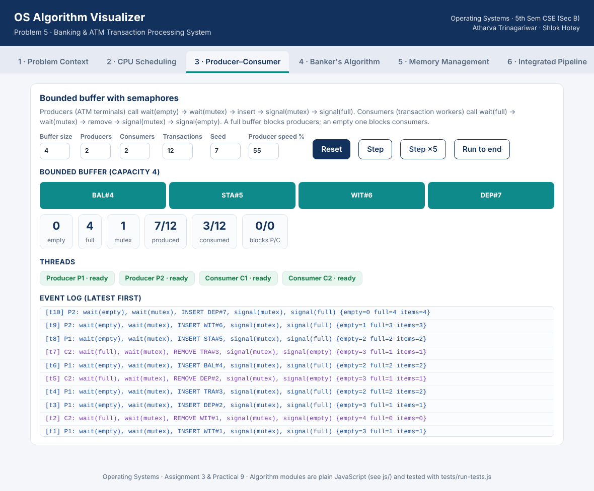
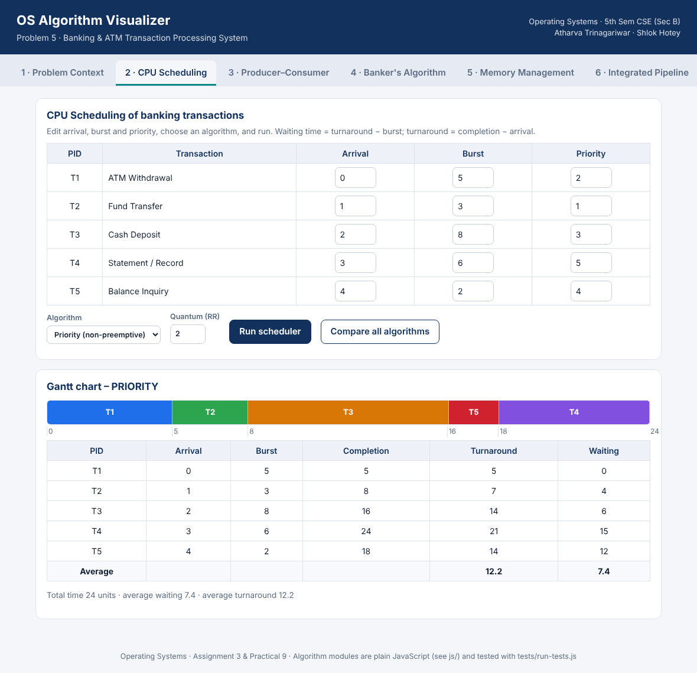

# OS Algorithm Visualizer – Banking & ATM Transaction Processing System

**Course:** Operating Systems · 5th Sem CSE (Section B)
**Assignment:** No. 3 (Complex Problem-Solving Case Study) + Practical No. 9 (Mini-Project)
**Subject Teacher:** Dr. Pallavi Wankhede
**Problem statement chosen:** Problem 5 – Banking and ATM Transaction Processing System
**Team:** Atharva Trinagariwar, Shlok Hotey

A browser-based visualizer that demonstrates four core Operating Systems mechanisms working together on one
real-world scenario: a bank that processes ATM withdrawals, deposits, fund transfers, balance inquiries and
statement generation concurrently.

| OS concept | Module | What it shows in the banking scenario |
|---|---|---|
| CPU Scheduling | `js/scheduler.js` | FCFS, SJF, SRTF, Priority, Round Robin – Gantt chart, waiting & turnaround time |
| Process Synchronization | `js/prodcons.js` | Bounded-buffer Producer–Consumer with `empty`, `full` semaphores and a `mutex`; step-by-step log |
| Deadlock Avoidance | `js/banker.js` | Need matrix, safety algorithm, safe sequence, resource-request algorithm |
| Memory Management | `js/memory.js` | First / Best / Worst Fit on fixed partitions, internal & external fragmentation analysis |
| **Integration** | `js/integrated.js` | Request → bounded buffer → memory partition → Banker's safety → CPU scheduler |

## How the four mechanisms work together

1. **Producer–Consumer** – ATM terminals / web channels (producers) place transaction requests into a bounded
   buffer; dispatcher workers (consumers) take them out. This fixes the **admission order** and prevents lost,
   duplicated or corrupted requests.
2. **Memory management** – each admitted transaction needs a memory partition. A transaction with no suitable
   partition waits and is not scheduled.
3. **Banker's algorithm** – shared resources (DB connections, transaction-service threads, ledger locks) are
   only committed if the system stays in a **safe state**, so concurrent transactions cannot deadlock.
4. **CPU scheduling** – transactions that hold memory *and* are cleared by Banker's are scheduled; waiting and
   turnaround times are calculated.

## Run it

No build step and no dependencies – open `index.html` in any modern browser.

```
git clone <your-repo-url>
cd os-visualizer
# open index.html in a browser (double-click, or:)
python3 -m http.server 8000      # then visit http://localhost:8000
```

## Run the tests

Requires Node.js 18+. The algorithm modules are plain JavaScript and are tested without a browser:

```
node tests/run-tests.js
```

26 automated tests cover hand-calculated scheduling results, the Banker's Need matrix / safe sequence /
request outcomes, all three memory strategies, bounded-buffer invariants (`empty + full = N`,
`0 ≤ items ≤ N`, FIFO order) and the integrated pipeline.

## Project structure

```
os-visualizer/
├── index.html            # app shell
├── css/style.css
├── js/
│   ├── context.js        # shared banking scenario data (5 transactions, resources, partitions)
│   ├── scheduler.js      # CPU scheduling
│   ├── prodcons.js       # producer–consumer / semaphores
│   ├── banker.js         # Banker's algorithm
│   ├── memory.js         # memory allocation + fragmentation
│   ├── integrated.js     # end-to-end pipeline
│   └── ui.js             # tabs, tables, Gantt chart, buffer and memory visualisations
├── tests/run-tests.js
└── docs/screenshots/
```

## Scenario data (editable in the UI)

| PID | Transaction | Arrival | Burst | Priority | Memory (KB) |
|---|---|---|---|---|---|
| T1 | ATM Withdrawal | 0 | 5 | 2 | 212 |
| T2 | Fund Transfer | 1 | 3 | 1 | 417 |
| T3 | Cash Deposit | 2 | 8 | 3 | 112 |
| T4 | Statement / Record | 3 | 6 | 5 | 426 |
| T5 | Balance Inquiry | 4 | 2 | 4 | 90 |

Banker's resources: A = DB Connections (10), B = Transaction Service Threads (5), C = Ledger Locks (7).
Memory partitions: 100, 500, 200, 300, 600 KB.

## Key results

* **Scheduling:** SJF gives the lowest average waiting time (5.6); Priority gives 7.4; FCFS 8.2.
  Priority is used in the integrated run because fund transfers must be served first.
* **Banker's:** the initial state is **safe**; a safe sequence exists. Request T2 (1,0,2) is granted; T5 (3,3,0)
  must wait; T1 (0,2,0) is denied as unsafe.
* **Memory:** First Fit leaves T4 (426 KB) without a partition (569 KB internal fragmentation);
  Best Fit places all five transactions (443 KB internal fragmentation).

## Screenshots







## Upload to GitHub

```
git init
git add .
git commit -m "OS Algorithm Visualizer - Banking & ATM Transaction Processing"
git branch -M main
git remote add origin https://github.com/<your-username>/os-algorithm-visualizer.git
git push -u origin main
```
Then paste the repository link into the Google Form.
